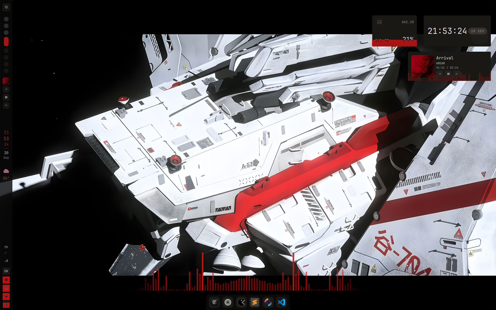
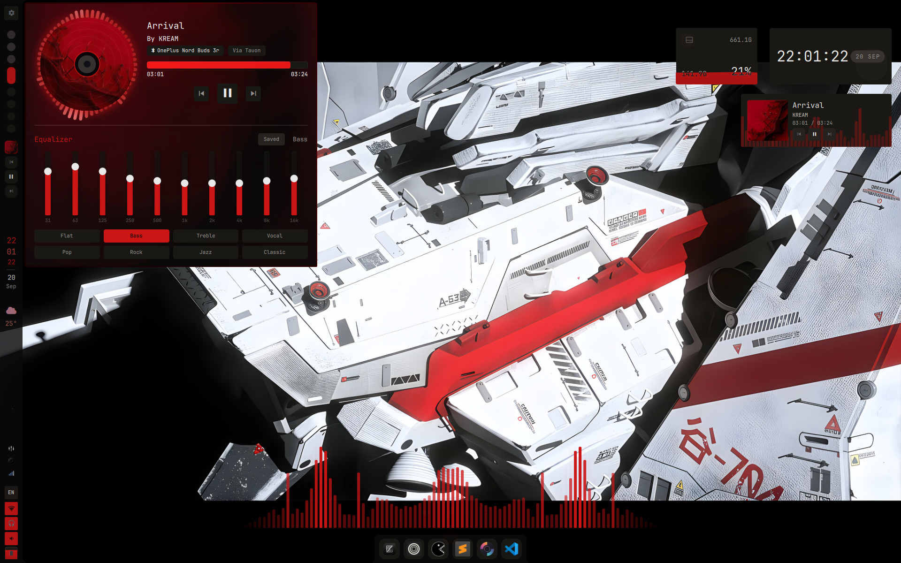
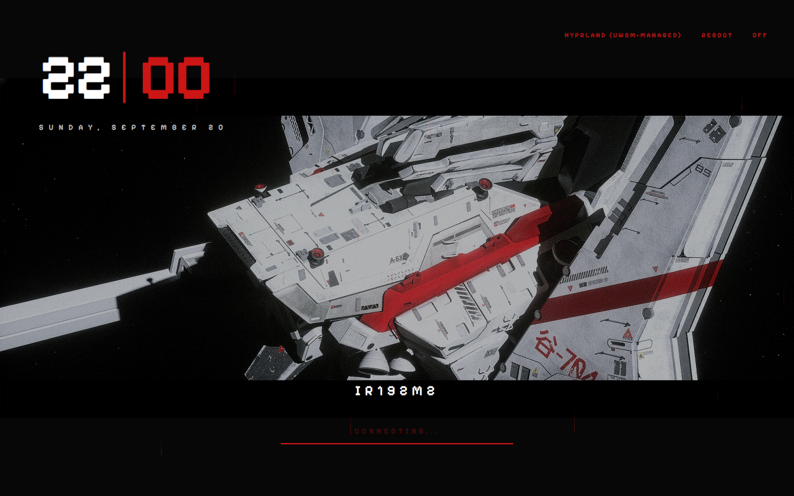
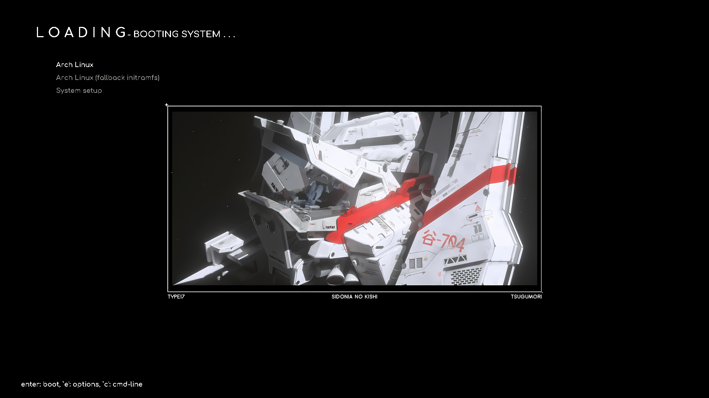

# Shidonia-no-Kishi (Serpantinum plugin)

Sidonia-themed customization pack for the stock
[Serpantinum](https://github.com/ilyamiro/serpantinum) shell. This is **not a
fork**: the updater, version checks, and the Settings Update button all track
the upstream original. This repo only carries the Shidonia customizations and
re-applies them on top of the stock install.

|  |  |
|  |  |

## Install (single file)

Pinned release (recommended):

```bash
curl -fsSL https://github.com/Copernicium282/Shidonia-no-Kishi/releases/download/v1.0.1/shidonia-install.sh -o /tmp/shidonia-install.sh
bash /tmp/shidonia-install.sh
```

From a checkout:

```bash
bash install.sh
```

No clone needed:

```bash
bash -c 'eval "$(curl -fsSL https://raw.githubusercontent.com/Copernicium282/Shidonia-no-Kishi/master/install.sh)"'
```

Requirements: a stock `ilyamiro/serpantinum` install. Coming from the old
Shidonia fork build? Run the upstream installer once first, then this:

```bash
bash -c 'eval "$(curl -fsSL https://raw.githubusercontent.com/ilyamiro/serpantinum/master/install/install.sh)"'
bash install.sh
```

## What it customizes

- **Shell theme**: Tsugumori preset + Sidonia palette, JetBrains Mono,
  left bar at 48px (`bar.thickness`), bar content scaled to match.
- **Shell code** (re-applied as patches, so upstream refactors fail loudly
  instead of silently reverting): bar thickness support, side weather /
  timedate scaling.
- **Login + boot**: `sidonia-no-kishi` SDDM theme (set as current) and GRUB
  theme, system-wide dark mode, telemetry off, extra packages
  (`gsettings-desktop-schemas`, `overskride-bin` when an AUR helper exists).

## How updates survive

`install.sh` stages the plugin persistently at
`~/.local/share/shidonia-plugin` (the upstream installer never touches that
path) and `plugin/apply.sh` patches the installed Settings About page so the
**Update** button runs:

```
upstream install.sh  →  plugin apply.sh --post-update
```

So a Settings-driven update installs stock upstream first, then the plugin
re-overlays everything in the same terminal (sudo can still prompt):

- Files already intact are left alone; files the update wiped are restored.
- User settings are merged with snapshot semantics: keys you never touched
  follow the plugin defaults, keys you edited yourself are never overwritten.
- The SDDM login theme is re-asserted (stock updates reset it to
  `material-you`); GRUB/darkmode/config persist on their own.

If a patch ever stops applying (upstream refactored those files), apply
aborts that patch with an error and everything else still runs — update the
patch in `plugin/patches/` and re-run.

Re-running `bash install.sh` (or `apply.sh --post-update`) at any time is
safe and converges to the same state.

## Credits

- [Serpantinum](https://github.com/ilyamiro/serpantinum) by [Illia Miroshnichenko](https://github.com/ilyamiro) — the shell this plugin customizes.
- [Sidonia](https://github.com/Aleph1-9012/Sidonia) — the Sidonia GRUB theme collection that inspired the aesthetic.
- [Tsugumori](https://github.com/Aleph1-9012/Tsugumori) — the *Aleph* wallpaper set and palette.
- [Qylock · pixel-night-city](https://github.com/Darkkal44/qylock) by [Darkkal44](https://github.com/Darkkal44) — base QML for the `sidonia-no-kishi` SDDM greeter.
- [Yorha GRUB](https://github.com/OliveThePuffin/yorha-grub-theme) by [OliveThePuffin](https://github.com/OliveThePuffin) — base for the bundled GRUB theme (recolored with the Sidonia palette).
